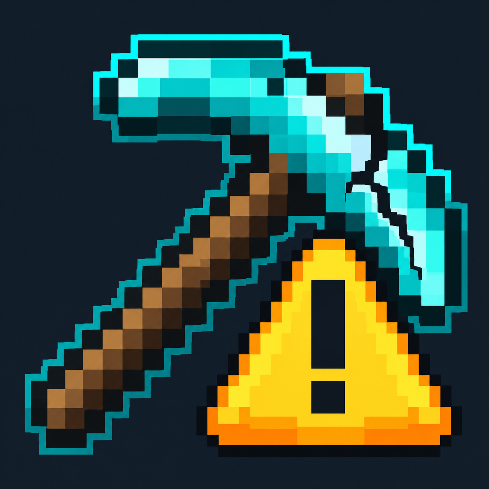

# Durability Alarm

A client-side Fabric mod that warns you when your items are running low on durability.

**Minecraft 26.3 · Fabric · Version 1.0.3 · Author: Zadko · MIT**

[Русская документация](README_RU.md) · [Changelog](CHANGELOG.md) · [License](LICENSE)

## Features

- On-screen warnings and sound alerts for tools, weapons, armor, elytra, shields, and other damageable items.
- Orange warnings at **10%** remaining durability and red warnings at **3%** by default. Both thresholds are configurable.
- Item icons, names, exact remaining durability, percentages, and inventory locations in the HUD.
- Monitoring of the main inventory, hotbar, equipment, offhand, and the item held by the cursor. An equipment-only scan mode is also available.
- Automatic paging when several items need attention, with reminders as items continue to wear down.
- Settings opened with **K**, including panel position, row count, sound volume, chat messages, and reminder interval.
- A **Test warning** button that previews an alert without changing your items.
- English and Russian translations.
- Support for modded items that use Minecraft's standard durability system.

The mod reports remaining durability. It does not predict an exact time until an item breaks or automatically prevent breakage.

## Requirements

| Component | Required version |
| --- | --- |
| Minecraft Java Edition | 26.3 |
| Fabric Loader | 0.19.5 or later |
| Fabric API | 0.161.0+26.3 or later for Minecraft 26.3 |
| Java | 25 or later; building uses JDK 25 |

Install the mod on the **client**. Server installation is not required.

## Install

1. Set up Minecraft 26.3 with Fabric Loader and Fabric API.
2. Place the compiled `durability-alarm-1.0.3+mc26.3.jar` in the instance's `mods` directory.
3. Start the game and press **K** in a world to configure the mod or preview a warning.

This repository contains source code. The `-sources.jar` artifact is not an installable mod.

## Build from source

Install **JDK 25**. The included Gradle Wrapper downloads the required Gradle version and dependencies on first use.

Linux / macOS:

```bash
chmod +x gradlew
./gradlew build
```

Windows PowerShell:

```powershell
.\gradlew.bat build
```

Output: `build/libs/durability-alarm-1.0.3+mc26.3.jar`.

`./gradlew logicTest` runs the standalone alarm-logic checks. The `build` task includes these checks as well.

## Configuration and scope

- Open settings with **K**; rebind it in Minecraft's Controls menu if needed.
- Configuration is saved in `config/durability-alarm.json` inside the game directory.
- Warnings are disabled in Creative mode by default and always disabled in Spectator mode.
- Items inside containers such as chests, shulker boxes, and bundles are not scanned. Custom accessory slots are not supported.
- Unbreakable items are ignored. Custom durability systems require a separate integration.

## Project files

- [Russian guide](README_RU.md)

## License and credits

Mod source code: [MIT License](LICENSE), copyright 2026 **Zadko**.

The Gradle Wrapper is distributed under [Apache License 2.0](LICENSE-Gradle.txt). Icon credits are listed in [ASSET_CREDITS.md](ASSET_CREDITS.md).
